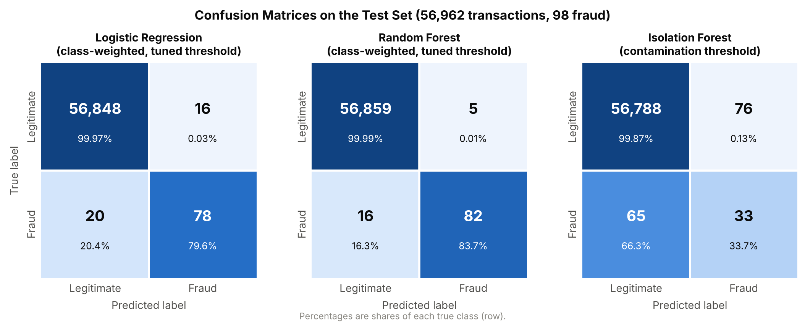
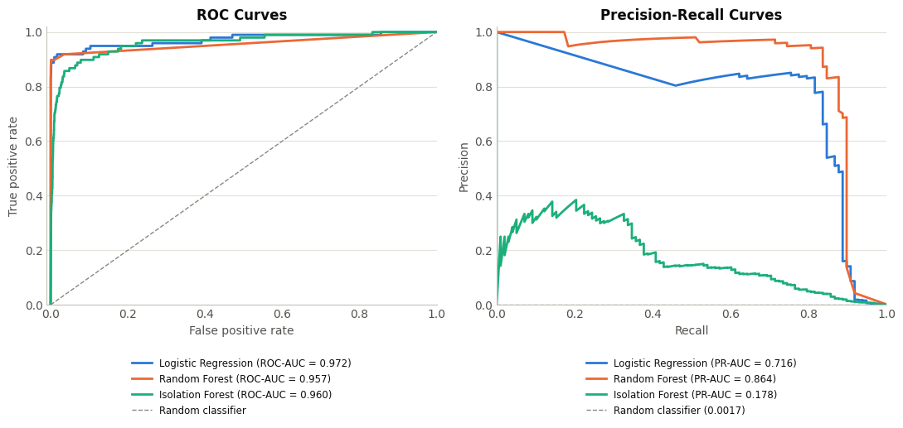
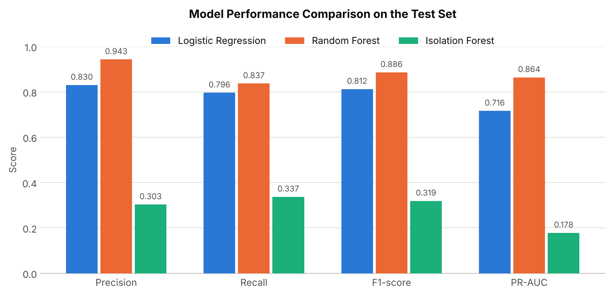
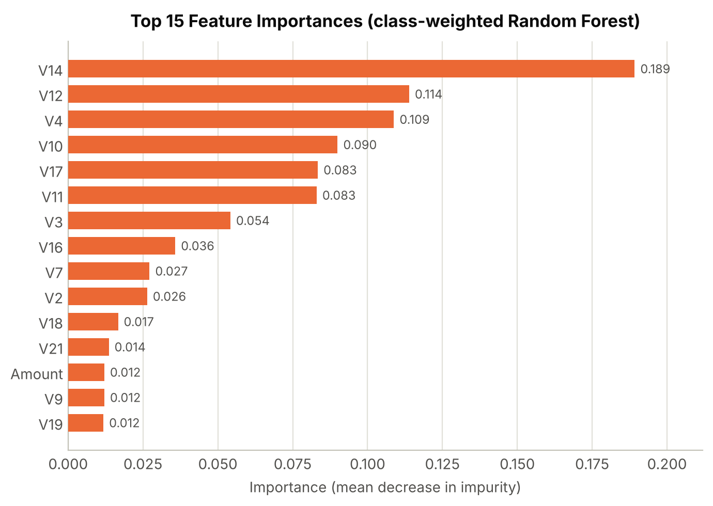
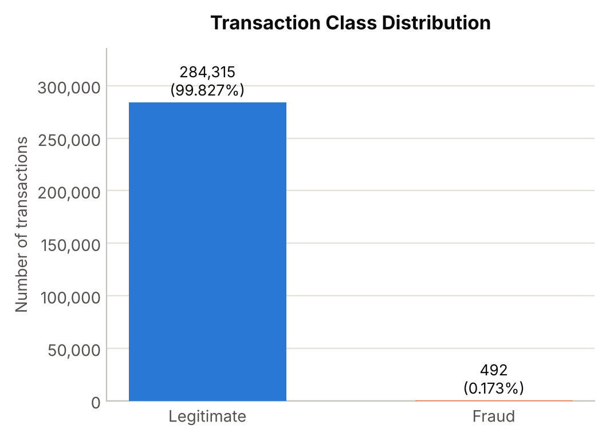
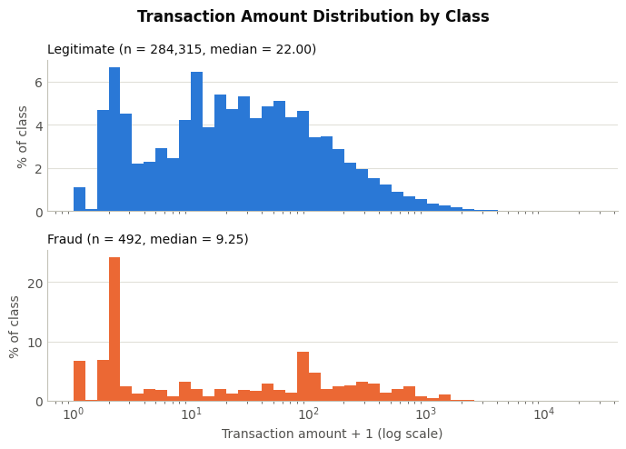

# Fraud Detection in Highly Imbalanced Digital Banking Transactions

[](https://colab.research.google.com/github/AdniNisrina/fraud-detection-imbalanced/blob/main/fraud_detection.ipynb)

A comparison of supervised and unsupervised machine learning for detecting fraud when it makes up only **0.173%** of transactions. Built for CSCI 4343 Data Science at the International Islamic University Malaysia (IIUM).

Fraud detection on this dataset has been widely studied, so the focus here is a rigorous comparison rather than a new algorithm:

- **No information leakage.** Scaling and SMOTE are fitted inside each cross-validation fold, never on validation or test data.
- **Thresholds tuned on validation data.** Each model's decision threshold is chosen from out-of-fold predictions, then applied once to a held-out test set.
- **Metrics that suit imbalanced data.** Precision, recall, F1 and PR-AUC instead of accuracy, which would be 99.8% for a model that never flags fraud.

## Results

Test set: 56,962 transactions, 98 of them fraud.

| Model | Threshold | Precision | Recall | F1 | PR-AUC |
|---|---|---|---|---|---|
| Logistic Regression (class-weighted) | Tuned (≈1.00) | 83.0% | 79.6% | 81.2% | 0.716 |
| **Random Forest (class-weighted)** | **Tuned (0.33)** | **94.3%** | **83.7%** | **88.6%** | **0.864** |
| Isolation Forest (unsupervised) | Contamination | 30.3% | 33.7% | 31.9% | 0.178 |

**Key findings**

- **Random Forest with class weighting performed best.** At its tuned threshold it caught 82 of 98 fraud cases with only 5 false alarms.
- **SMOTE did not beat simple class weighting.** Cross-validation PR-AUC was 0.748 vs 0.746 for Logistic Regression, and 0.802 vs 0.839 for Random Forest.
- **Threshold tuning was the biggest single improvement.** For Logistic Regression it cut false alarms from 1,386 to 16 and raised precision from 6.1% to 83.0%.
- **ROC-AUC is misleading here.** Isolation Forest scored a ROC-AUC of 0.960 while catching only a third of fraud cases; its PR-AUC of 0.178 tells the real story.
- **A few features drive detection.** Mann–Whitney U tests (Bonferroni-corrected) found 24 of 30 features significant; V14, V4, V12, V11 and V10 had the largest effect sizes, and largely the same features top the Random Forest importances.





<details>
<summary>More figures</summary>






</details>

## Method

1. **Data:** [Kaggle Credit Card Fraud dataset](https://www.kaggle.com/datasets/mlg-ulb/creditcardfraud): 284,807 European card transactions from September 2013, 492 of them fraud. Features V1–V28 are PCA-anonymised; `Time` and `Amount` are standardised.
2. **Hypothesis tests:** Mann–Whitney U test per feature with Bonferroni correction, plus rank-biserial correlation as the effect size.
3. **Split:** stratified 80/20 train/test split (227,845 / 56,962 rows). The test set is used once, at the end.
4. **Models:** Logistic Regression and Random Forest (200 trees), each with class weighting and with SMOTE; Isolation Forest trained without labels.
5. **Evaluation:** 5-fold stratified cross-validation, F1-maximising threshold from out-of-fold predictions, then a single test-set evaluation.

## Run it

**Google Colab (easiest):** click the badge above, then **Runtime → Run all**. The dataset downloads automatically from Kaggle.

**Locally:**

```bash
pip install -r requirements.txt
python fraud_detection.py
```

The script looks for `creditcard.csv` in the current folder and otherwise downloads it with `kagglehub`. Figures and results are written to `outputs/`. A full run takes about 1–1.5 hours on a free Colab CPU, almost all of it in the Random Forest cross-validation.

## Repository contents

| Path | What it is |
|---|---|
| `fraud_detection.ipynb` | The analysis as a notebook, with the outputs from the run reported here |
| `fraud_detection.py` | The same analysis as a single script |
| `figures/` | All figures from the run |
| `results/results.txt` | Full printed output: statistical tests, per-fold scores, test results |
| `report/` | The technical report (PDF) |

## Limitations

- The data are 2013 European credit card transactions, used as a proxy because no public Islamic banking transaction data exists.
- With only 98 fraud cases in the test set, each case is worth about one percentage point of recall, so small differences between models should be read cautiously.
- Transactions were split randomly rather than by time; a time-based split would better reflect real deployment.

## Authors

Adni Nisrina binti Zailanee, Umairah Izzati binti Badly Shah, Arif Haikal bin Shamsul Kamarul Adzhar, Muhammad Alif Altaf bin Abd Rahim

Department of Computer Science, Kulliyyah of Information and Communication Technology (KICT), IIUM
